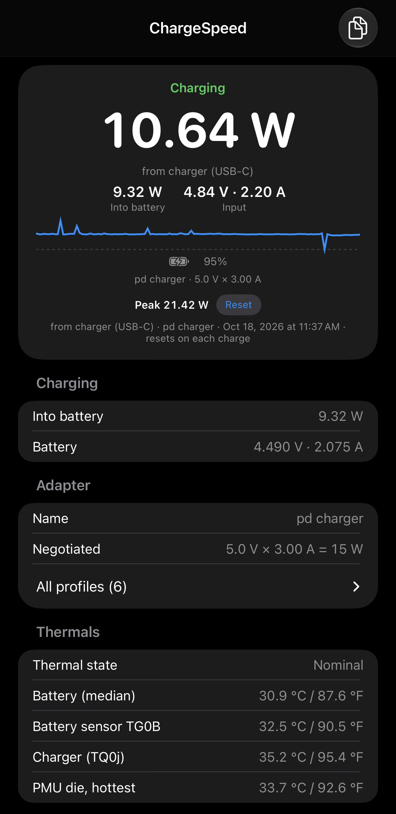

# ios-charging-monitor

ChargeSpeed: live charging power on an iPhone, read from the phone's PMU and charger sensors via
private APIs. Build it yourself, install on your own phone. Cannot ship on the App Store because of the private
APIs it uses (see below).



## Why

To compare chargers and cables. iOS shows a lightning bolt and nothing else. Seeing the wattage
exposed a few bad charging setups I'd been using. It also shows what a wireless charger actually
negotiates (for example MagSafe 15 W versus Qi 7.5 W) and what reaches the battery.
And it finds the sweet spot on a wireless charger with no magnets, like a car tray: slide the phone
around with the live watts on screen until the number peaks.

## What it shows (verified on iPhone 17 Pro Max / iOS 26 and iPhone 18 Pro Max / iOS 27)

- Watts from the charger, 1 s updates, sparkline. USB-C input voltage × current. On MagSafe there
  is no input current sensor, so the headline is watts into the battery instead.
- Watts into the battery, battery voltage and current.
- Peak watts for the current charge, kept on screen after unplugging, reset at the next plug-in.
- Adapter name, negotiated USB-PD profile, full profile list.
- Temperatures: battery, charger junction, hottest SoC die, and iOS's thermal state with a red
  "Throttling" line at serious or critical. The battery gauge publishes four temperature keys
  (TG0B, TG0C, TG0H, TG0V); three agree and track the cell, while TG0B sits near the connector and
  runs up to 10 °C hotter under charge current. Earlier builds showed the hottest of the four as
  the battery, which flagged a cool phone as hot on the iPhone 18 Pro's higher current. The battery
  row is now the median of the four, and TG0B is shown separately as "Battery gauge board".
  Battery turns amber at 38 °C, red at 42 °C.
- Percent, charging state, low power mode.
- A charging hold below 100 % (Optimized Battery Charging or charge limit), inferred from behaviour.
- Raw sensor and dictionary dumps, collapsed.

## What iOS hides from apps

Tried and blocked by the sandbox on iOS 26 and 27; the simulator shows them because it reads the Mac:

- Battery health, cycle count, mAh capacity, design capacity (IOKit registry filtered to two keys).
- Optimized Battery Charging, charge limit, and Clean Energy Charging settings (PowerUI XPC denied).
- powerd's "Charging On Hold" status and time-to-empty (privileged, or always 0).
- Discharge current on battery: no sensor exists, so no time-to-empty from power.

Details in [CLAUDE.md](CLAUDE.md).

## iPhone 18 Pro reads half above ~30 W

The 18 Pro charges through two circuits once it draws more than about 30 W wired. Only the first
has sensors. The second carries current the app cannot see, so the input and battery readings show
roughly half the true value.

Measured on an iPhone 18 Pro Max, iOS 27, plugged into a 45 W adapter with a built-in wattage
display, battery at 55 %, app and display read side by side over four minutes:

| Display charger | App | Ratio |
|---|---|---|
| 33.8 W | 18.4 W | 0.54 |
| 43.8 W | 22.0 W | 0.50 |
| 43.8 W | 21.8 W | 0.50 |
| 42.3 W | 21.4 W | 0.51 |
| 38.2 W | 18.4 W | 0.48 |

During the split the metered input current sat at 1.50 A of a 3.00 A contract, and the battery
current halved the same way. None of the other 120-odd sensors moved.

When the metered circuit sits at half the negotiated PD current for ten seconds, the app shows an
orange line with the reading doubled. That is an assumption, not a measurement: it holds only if
the two circuits share equally, which they did throughout the test above. The headline number is
never altered. The line clears on unplug or if the metered current ever exceeds what an equal
split allows.

Not seen on the 17 Pro Max. Expect it on any future iPhone rated 50 W or more.

## Versus App Store "charging speed" apps

There are apps on the App Store that claim to show charging wattage. They can't read the sensors,
because Apple doesn't expose them to third-party apps, so they guess: watch the battery percentage
tick up, multiply by the battery's rated capacity, divide by time. That's close enough on a good
day, minutes behind at best, and wrong whenever the phone throttles or pauses charging. I wanted
the real number.

This reads the sensors. The same estimate is kept as a fallback ("% rate"). Private APIs are why
this can't be published: Guideline 2.5.1, and TestFlight scans too.

## IPA

Unsigned, in [Releases](https://github.com/gregsramblings/ios-charging-monitor/releases). Sign it with
your own Apple ID using any sideloading tool (AltStore, Sideloadly, and similar). Free Apple ID
signatures last 7 days, paid developer accounts one year. The app needs no entitlements, so nothing
special is required. I don't provide support for the sideloading step; use the tool's own docs.

## Build and install

Xcode and [XcodeGen](https://github.com/yonaskolb/XcodeGen). A free Apple ID is enough; no paid
Apple Developer Program membership needed.

```bash
xcodegen generate
open ChargeSpeed.xcodeproj
```

1. Target → Signing & Capabilities → your team (or `DEVELOPMENT_TEAM` in `project.yml`, regenerate).
2. Phone: Settings → Privacy & Security → Developer Mode.
3. Run.
4. First launch: Settings → General → VPN & Device Management → trust.

Free Apple ID: 7-day expiry, 3 sideloaded apps, own devices only. Paid Apple Developer Program:
1-year signing, ad hoc distribution to 100 devices. Simulator works but reads the Mac's battery.

Private APIs can change or disappear in any iOS update.

## License

MIT. See [LICENSE](LICENSE).
